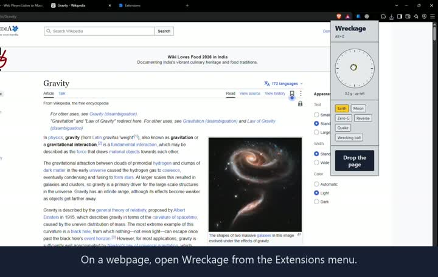

# Wreckage

Press **Alt+G** on a webpage to make its headings, images, buttons, and paragraphs fall. Grab a piece, drag it, and release to throw it. Press **Esc** to restore the page and your scroll position.

Wreckage is a Chrome extension built with Matter.js. It simulates up to 150 visible page elements at a time.

## Install in Chrome

[Watch the 30-second installation walkthrough](docs/media/install-and-open.mp4)

1. [Download Wreckage ZIP](downloads/wreckage.zip?raw=true) and extract it to a folder you can keep.
2. Open `chrome://extensions` and enable **Developer mode**.
3. Click **Load unpacked** and select the extracted folder containing `manifest.json`.

Open a regular webpage and press **Alt+G** to try it. Chrome loads Wreckage from the folder you selected, so keep that folder in place.

## Install from source

1. Clone the repository and open a terminal in its root directory.
2. Run `npm ci`, then `npm run build`.
3. Open `chrome://extensions` and enable **Developer mode**.
4. Click **Load unpacked** and select the generated `dist/` folder.

To try it, open a Wikipedia article, scroll to a section with an image, and press **Alt+G**. You can also open Wreckage from the toolbar and click **Drop the page**.

## Gravity and modes

Open the toolbar popup while the simulation runs. Drag the yellow ball toward the direction you want the pieces to fall. The farther it sits from the center, the stronger the pull, up to 2 g. You can also focus the dial with **Tab** and move the ball with the arrow keys.

| Mode | What happens |
| --- | --- |
| Earth | Pieces fall in the direction set by the dial. |
| Moon | Gravity drops to 17% of Earth's pull. |
| Zero-G | Moving pieces drift until they collide. |
| Reverse | Gravity pulls in the opposite direction. |
| Quake | A two-second series of jolts shakes moving pieces. |
| Wrecking ball | A heavy ball follows your cursor and knocks pieces aside. |

To finish, press **Esc** on the page, press **Alt+G** again, or select **Put it back** in the popup.

## Privacy and permissions

The simulation runs in your browser. Wreckage collects no user data and makes no network requests of its own.

| Permission | Purpose |
| --- | --- |
| `activeTab` | Access the current tab when you invoke Wreckage. |
| `scripting` | Run the bundled simulation on that tab. |
| `storage` | Remember mode and gravity preferences through Chrome's sync storage. |

## Development

Run `npm run dev` for development, `npm run lint` for static checks, and `npm run build` for a production build. The [browser regression tests](tests/edge_cases.py) include setup and run instructions.

## License

Wreckage uses the [MIT License](LICENSE). The bundled Archivo font uses the [SIL Open Font License](public/Archivo-LICENSE.txt).
